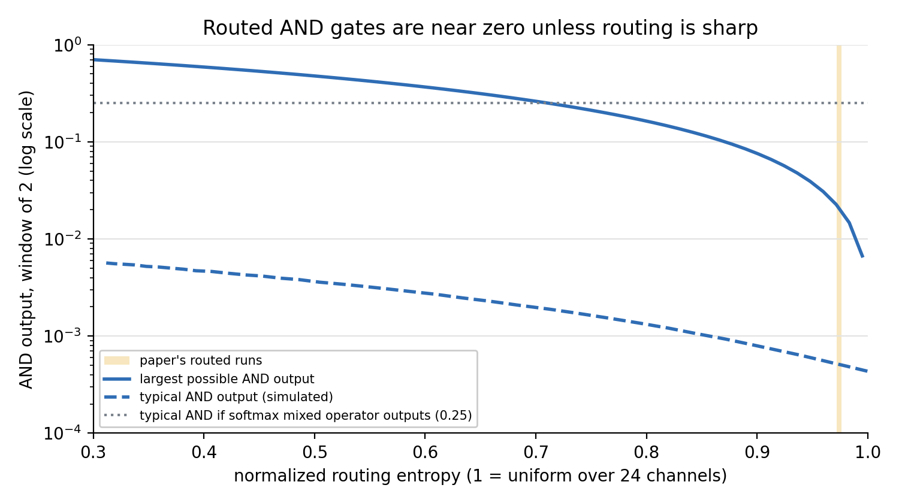

# Why operator routing adds nothing, and what to try next

Deep-research note, 2026-10-07. Scope: the paper's null result (routed logic expert ≈ No-Gate Control),
read against the model code and the literature. No model was run; the analysis below uses the code, the
logged metrics in `docs/verification/results/raw/`, and arithmetic.

## Bottom line

1. **The AND/OR/NOT gates almost certainly never operated as logic.** The router's softmax multiplies the
   gate *inputs*, so with routing spread over 24 channels every gate input is at most about 0.15 and
   typically about 0.02. In that range AND is ≈ 0, OR is a plain sum, and NOT is 1 − input. The operator
   bank is an affine map of `sigmoid(·) × softmax(·)`, a gated-linear layer, not a logic layer.
2. **That one fact predicts all four flat results in Table 1**, so the null result says the design never
   tested logic composition. It does not say logic composition fails.
3. **The published logic-gate-network design does this differently:** its softmax mixes operator
   *outputs* and leaves inputs at full scale (Petersen et al., 2022). Switching to that is a small code change.
4. **The benchmark also leaves little room:** in-distribution ProofWriter is solved by fine-tuned
   transformers (99.6% answer accuracy on the full data). Recent work finds logic modules match plain
   heads in-distribution and only help on compositional, low-data or out-of-distribution tests.

## Finding 1: the gates sit in their linear regime

From `core/logic_layer.py`: `gate_values = sigmoid(gate_scalar(x)) * routing_weights`, where
`routing_weights` is a softmax over 3G = 24 channels (G = 8 gates per operator, window size 2,
temperature 1, dense routing at evaluation). So each gate input `u ≤ π`, its routing weight.

**Bound, not simulation.** The paper reports normalized routing entropy 0.972–0.976 (computed per token,
then averaged). For a given entropy the largest single weight occurs when one channel is peaked and the
other 23 share the rest. At 0.972 that weight is 0.149. Hence, whatever the sigmoids do:

| Operator (window of 2) | Output | In this regime |
|---|---|---|
| AND = u₁·u₂ | ≤ 0.149² ≈ 0.022 (typical ≈ 0.0004) | effectively off, and its gradient (the other input, ≈ 0.02) is tiny |
| OR = u₁ + u₂ − u₁u₂ | typically within ~1% of u₁ + u₂ (at most ~8% at the bound) | a linear sum |
| NOT = 1 − u | ≈ 0.98 | affine |

*Figure: largest possible AND output (solid) and a simulated typical value (dashed) against routing
entropy; the shaded band is where the paper's runs sat. The dotted line is the typical AND output if the
softmax mixed operator outputs instead (≈ 0.25). Script: `scripts/research/gate_regime.py`.*

**What the routed layer computes.** `Linear([≈0, u_t + u_{t−1}, 1 − u_t, 1 − u_{t−1}])` with
`u = sigmoid(W_g x) ⊙ softmax(W_r x)`: a gated product of two projections plus a one-token shift. The
No-Gate Control (`core/no_gate_layer.py`) is a per-token 3-layer GELU (Gaussian error linear unit) MLP
(multi-layer perceptron). Both are generic nonlinear per-token updates, so they should perform about the same.

**It retrodicts all four flat results:**

| Observed (paper) | Predicted by the mechanism |
|---|---|
| Routed ≈ No-Gate (−0.2 percentage points when used parameters are matched) | gates collapse to a gated-linear unit, same class as the MLP |
| Inter-token ≈ intra-token (0.927 vs 0.936) | the only window-dependent nonlinearity is the dead AND product |
| G = 8 ≈ G = 16 | more channels make each weight smaller, pushing deeper into the linear regime |
| Routing entropy stays ≈ 0.97 | sharpening a channel changes outputs almost linearly, so the router gets no incentive to specialize |

**Metric caveat.** `_extract_routing_entropy` counts padded positions (all-zero weights, renormalized) as
perfectly uniform, which inflates entropy. If a fraction f of positions is padding, real-token entropy is
(0.97 − f)/(1 − f). Even at f = 0.5 that is 0.94, giving a largest weight of 0.21 and an AND bound of
0.045. The conclusion holds; the metric should still exclude padding.

## Finding 2: how the literature does it

| Work | Relevance |
|---|---|
| Deep Differentiable Logic Gate Networks (Petersen et al., NeurIPS 2022) | Neuron output = Σᵢ pᵢ·fᵢ(a₁, a₂): softmax over 16 operators **mixes outputs**; inputs pass unchanged. Reports vanishing gradients past ~8–10 layers. |
| Convolutional DLGN (Petersen et al., NeurIPS 2024) | Near-uniform gate distributions at initialization cause vanishing gradients (gradient norm × 0.1–0.2 per gate); fixed by "residual initialization" (one gate at ~90%). Same failure class as here. |
| Light DLGN (ICLR 2026) | Argues the root cause is the gate parametrization, not initialization; an input-wise parametrization scales in depth. |
| Analyzing Differentiable Fuzzy Logic Operators (van Krieken et al., AI Journal 2022) | Product AND's derivative is the other input, so when both inputs are small the gradient is small: "not a sensible learning strategy". This is exactly the u ≈ 0.02 regime. |
| Hash Layers (Roller et al., NeurIPS 2021) | Fixed hash routing matches or beats learned routing in mixture-of-experts models; learned routers often add little. |
| Differentiable Fuzzy Inference Layer (Zhang & Alanwar, arXiv 2026) | t-norm head on Llama-3.1-8B and others: **parity in-distribution** (Llama −0.1), gains on compositional (+5.9), low-data (+11.7 to +16.5) and consistency (+5.5 points) tests. Same pattern as this paper. Baseline is a linear head, not a matched MLP. |
| Rule-based reasoning via neurosymbolic hidden-state vectors (Dhanraj & Eliasmith, EMNLP 2025) | Nearest hidden-state intervention prior: encode, compute, decode back into one layer's hidden state. |
| ProofWriter (Tafjord et al., 2021) | T5 answer accuracy 99.6% on depth-5 closed-world test with full training data. Train on depth ≤ 3, test on depth 5 is the standard out-of-distribution split. |
| On the Paradox of Learning to Reason from Data (Zhang et al., IJCAI 2022) | BERT is near perfect in-distribution on SimpleLogic but fails across distributions: it learns statistical shortcuts, not inference. |

So the "near ceiling" claim in the paper (Baseline 0.925) is relative to the 10,000-example budget; with
full data, plain fine-tuning reaches ~99.6%. Remaining in-distribution errors look like data or training
limits, not missing reasoning machinery.

## Proposed experiments (all compute on the Oregon State HPC cluster)

Pre-registered rule as in the paper: a difference counts only if the seed-paired mean is positive and
exceeds two standard errors (SE).

| ID | Experiment | Cost | Pre-registered criterion |
|---|---|---|---|
| E0 | Diagnostic: one forward pass of a retrained routed model, logging per layer the gate input u, AND output, and |OR − (u₁ + u₂)|/OR on real (unpadded) tokens. No checkpoints were saved, so this has never been measured on trained weights. | one training run plus a forward pass | Mechanism confirmed if mean AND < 0.01 and OR deviates from a plain sum by < 5%. If not, Finding 1 is wrong; stop and re-analyze. |
| E1a | Minimal fix: rescale inputs `u = s · π · 3G` (clipped to [0, 1]) so uniform routing passes full-scale sigmoids. | 1 line; 3 seeds | Proceed if E0 statistics show the nonlinear regime (mean AND > 0.05). |
| E1b | Principled fix (DLGN-style): `Σₖ πₖ · opₖ(s)`, softmax over operator outputs, optionally residual-style initialization. | small; 3 seeds | Same as E1a. |
| E2 | Headroom split: ProofWriter train depth ≤ 3, test depth 5; fallback SimpleLogic across distributions. | 3 models × 3 seeds | Pre-check: Baseline must score < 0.95 on the test split, else use the fallback. |
| E3 | Free fixes: exclude padding from the entropy metric; keep logic modules and fusion α in fp32 (bfloat16 currently rounds away small updates). | none | Apply to every run above. |

**Kill rule for the idea at this scale:** if, with E0 confirming the operators run nonlinearly
(mean AND > 0.05), the routed model without cross-attention fails to beat the No-Gate Control by
> 2 SE on 3 seeds both in-distribution and on the E2 split, drop operator routing for 8B fine-tuning.

## Limits of this analysis

- The regime claim is a bound from the logged entropy plus the code, not a measurement of trained
  activations (E0 fixes that). Entropy is a token average; a minority of tokens could route sharply, but
  even a fully peaked channel gives AND ≤ π² and needs π near 1 to act as logic.
- Padding inflates the logged entropy (corrected bound above).
- The "typical" curve in the figure assumes random logits and is illustration only.
- The arXiv page of the Differentiable Fuzzy Inference Layer paper shows a submission date of 17 Aug 2026
  under a September ID; it is cited as 2026.

## Sources

- [Deep Differentiable Logic Gate Networks](https://arxiv.org/abs/2210.08277) ([full text](https://ar5iv.labs.arxiv.org/html/2210.08277))
- [Convolutional Differentiable Logic Gate Networks](https://arxiv.org/abs/2411.04732)
- [Light Differentiable Logic Gate Networks](https://arxiv.org/abs/2510.03250)
- [Analyzing Differentiable Fuzzy Logic Operators](https://arxiv.org/abs/2002.06100)
- [Hash Layers For Large Sparse Models](https://arxiv.org/abs/2106.04426)
- [Differentiable Fuzzy Inference Layer](https://arxiv.org/abs/2609.26113)
- [Improving Rule-based Reasoning in LLMs using Neurosymbolic Representations](https://arxiv.org/abs/2502.01657)
- [ProofWriter](https://arxiv.org/abs/2012.13048)
- [On the Paradox of Learning to Reason from Data](https://arxiv.org/abs/2205.11502)
- [FaiRR: Faithful and Robust Deductive Reasoning](https://arxiv.org/abs/2203.10261)
